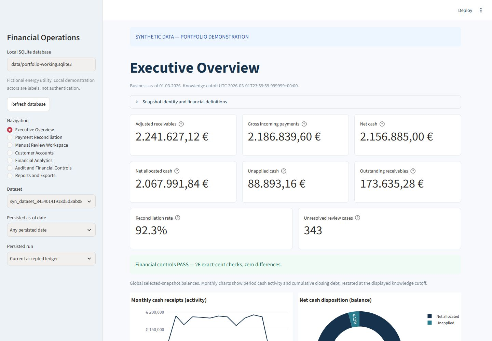
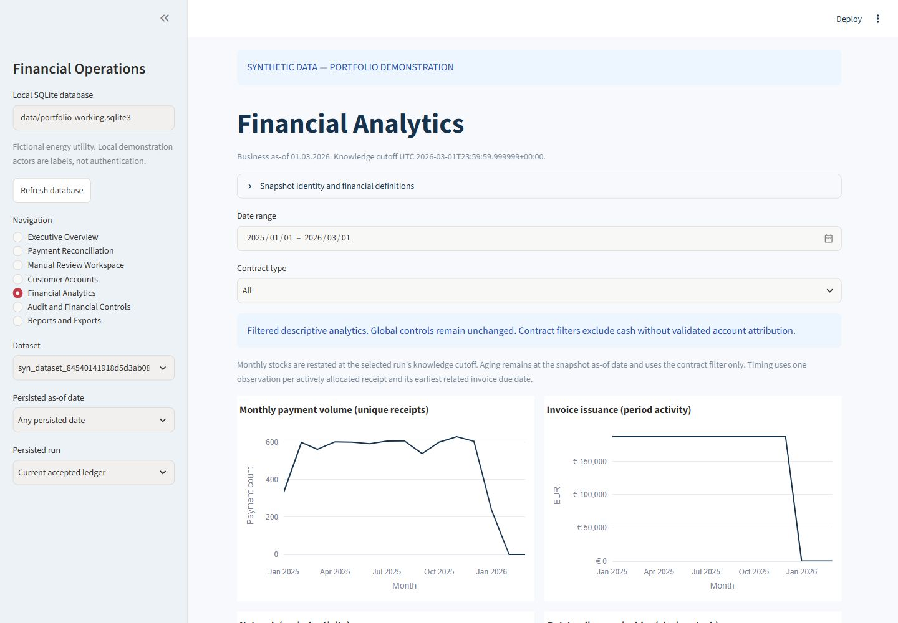
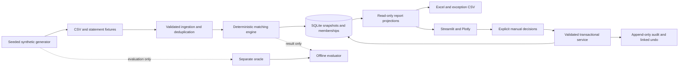

# Energy Payment Reconciliation & Financial Analytics

[](https://github.com/malak129/energy-payment-reconciliation-analytics/actions/workflows/ci.yml)
[](LICENSE)

A Python portfolio project that follows fictional energy bills from payment
matching through exception review, reversible operator decisions and financial
reporting. It brings together exact-cent controls, an auditable SQLite subledger,
Excel workbooks and a seven-page Streamlit dashboard.

**Synthetic data only.** This is an independent learning and portfolio project,
developed with AI-assisted engineering and verification. It is not an official
eins energie application, company project or integration, and implies no
affiliation, endorsement, company-data access or employment experience.




[Seven-page screenshot gallery](docs/SCREENSHOTS.md) ·
[Five-minute demo](docs/DEMO_GUIDE.md) ·
[Architecture](docs/ARCHITECTURE.md) ·
[Release verification](PHASE_8_VERIFICATION.md)

## Why this project

Payment operations teams need to establish which invoices a receipt settles,
investigate unclear references and explain residual cash or outstanding debt.
Incorrect automatic matches can conceal a problem rather than resolve it.

This simulation makes those decisions inspectable. Exact evidence supports an
automatic allocation; ambiguity remains visible in a review queue. An explicit
manual decision and linked undo preserve both the financial outcome and its history.
The focus is customer payment processing and receivables analysis. Purchasing,
supplier reconciliation and SAP connectivity are not implemented.

## What you can explore

| Capability | Implementation |
|---|---|
| Realistic fictional inputs | Seeded private/business customers, electricity/gas accounts, bills, statement copies, refunds, chargebacks and approved corrections |
| Conservative matching | Unique exact references, account/date/currency checks, explicit combined references; no fuzzy-name or amount-only authorization |
| Financial correctness | Integer EUR cents, per-entity bounds, cash/debt conservation and monthly flow-to-stock controls |
| Durable history | Immutable source records and runs, source hashes, selected-run effect memberships and application audit events |
| Manual review | Explicit targets, prepare/confirm UI, stale-version guards, retry keys, linked allocation reversal |
| Business reporting | 12 Excel worksheets, typed EUR/dates, native tables/charts, formula rechecks and exception CSV |
| Interactive analysis | Overview, payments, review workspace, accounts, analytics, audit/controls and exports |

## Verified results and what they mean

The default fixture uses seed 42, 500 customers and 12 billing periods. It contains
600 accounts, 7,200 invoices, 7,100 incoming payments and 7,296 unique bank events.
Five duplicate statement receipts add no cash.

| Synthetic default evaluation | Result |
|---|---:|
| Correct automatic allocation rows | 6,904 |
| Incorrect / missing expected allocation rows | 0 / 0 |
| Allocation precision: correct / produced rows | 100% (6,904 / 6,904) |
| Expected-row coverage: correct / expected rows | 100% (6,904 / 6,904) |
| Payments with positive active allocations after outflows | 6,757 / 7,100 (95.1690%) |
| Remaining review items, including residual credit | 343 |
| Exact-cent reporting controls | 26 passing; zero differences |

Evaluation reads a separately generated oracle **after** reconciliation. Runtime
matching never consumes intended relationships. These are results on an authored
synthetic fixture, not real-world accuracy estimates. Coverage, precision and
value-weighted settlement ratio have different denominators.

Phase 7 independently checked raw SQLite financial effects, source/output hashes,
every invoice/payment balance, account/customer totals and monthly stocks. Its
249 tests passed, including seeded property tests; combined statement/branch
coverage was 89.92%. Phase 8's local suite passes **250 tests**, including a new
fresh-baseline report-demo regression; current
checks and remote CI status are recorded in [release verification](PHASE_8_VERIFICATION.md).

## Architecture and workflow



The engine has no Streamlit or Excel dependency. UI and CLI reuse application
services; reporting reads accepted snapshots without rematching. See the
[architecture guide](docs/ARCHITECTURE.md) and [physical schema](DATABASE_ARCHITECTURE.md).

**Stack:** Python 3.11+, Pydantic, SQLAlchemy Core/SQLite, pandas, NumPy,
XlsxWriter, openpyxl, Streamlit and Plotly. Development checks use pytest,
Hypothesis, Ruff, coverage and pip-audit. Windows/Python 3.12 is locally verified;
the CI matrix exercises Ubuntu 3.11/3.12 and Windows 3.12. Its badge reflects
GitHub's actual status rather than a manually declared pass.

## Install on Windows

Install Python 3.12 and Git, then run these commands in PowerShell. No API key,
cloud account, real bank file or Microsoft Excel installation is required.

```powershell
git clone https://github.com/malak129/energy-payment-reconciliation-analytics.git
cd energy-payment-reconciliation-analytics
py -3.12 -m venv .venv
.\.venv\Scripts\python.exe -m pip install --upgrade pip
.\.venv\Scripts\python.exe -m pip install -e ".[dev]"
.\.venv\Scripts\python.exe -m energy_reconciliation doctor
```

Using the environment's interpreter directly avoids PowerShell activation-policy
changes. If `py` is unavailable, use `python -m venv .venv` with Python 3.11+.
On macOS/Linux, use `python3 -m venv .venv` and replace
`.\.venv\Scripts\python.exe` with `./.venv/bin/python` in the commands below.

## Quick start: preserve a baseline, explore a working copy

Run from the repository root. These paths must be new on the first run; existing
databases/exports are intentionally not reset or overwritten. The complete source
bundle is generated locally and is not stored in Git.

```powershell
.\.venv\Scripts\python.exe -m energy_reconciliation generate --seed 42 --output-dir data/portfolio
.\.venv\Scripts\python.exe -m energy_reconciliation db --database data/portfolio-baseline.sqlite3 init
.\.venv\Scripts\python.exe -m energy_reconciliation db --database data/portfolio-baseline.sqlite3 import --input-dir data/portfolio --actor SYNTHETIC_DEMO:portfolio --reason "Import synthetic portfolio data"
.\.venv\Scripts\python.exe -m energy_reconciliation db --database data/portfolio-baseline.sqlite3 reconcile --evaluation-date 2026-03-01 --known-at 2026-03-01T23:59:59.999999Z --actor SYNTHETIC_DEMO:portfolio --reason "Create reproducible baseline"
.\.venv\Scripts\python.exe -m energy_reconciliation db --database data/portfolio-baseline.sqlite3 controls
.\.venv\Scripts\python.exe -m energy_reconciliation report excel --database data/portfolio-baseline.sqlite3 --output-dir outputs/portfolio/baseline
.\.venv\Scripts\python.exe -m energy_reconciliation db --database data/portfolio-working.sqlite3 restore --backup data/portfolio-baseline.sqlite3
.\.venv\Scripts\python.exe -m streamlit run src/energy_reconciliation/dashboard/app.py --server.address 127.0.0.1 --browser.gatherUsageStats false -- --database data/portfolio-working.sqlite3 --exports outputs/portfolio/ui
```

Open the loopback URL printed by Streamlit. Keep the baseline untouched; make
manual demonstrations only in `portfolio-working.sqlite3`. Add `--read-only`
after the application arguments for viewing without financial edits.

Start with Executive Overview, filter payments, inspect a missing-reference case,
and compare an account's debt with its separately identified credit. Then prepare
an explicit allocation on the working copy, review it, confirm it and demonstrate
its linked undo. Candidate suggestions never authorize a match.
Follow the [demo guide](docs/DEMO_GUIDE.md) for the full safe sequence and exports.

## Financial interpretation

For accepted EUR events at a business/knowledge cutoff:

```text
Net cash = incoming receipts - refunds - chargebacks
Net cash = net allocated cash + unapplied cash
Adjusted receivables = original invoices + signed corrections
Adjusted receivables = net allocated cash + outstanding receivables
Unapplied cash = identified account credit + unidentified suspense
```

A release reopens debt without reducing cash a second time. A correction changes
receivables, not bank cash. Monthly movements are distinct from cumulative closing
balances. Check individual entity bounds as well as global equations: offsetting
mistakes can otherwise cancel. [Financial controls and worked example](docs/FINANCIAL_CONTROLS.md).

## Test and reproduce acceptance

```powershell
.\.venv\Scripts\python.exe -m ruff check .
.\.venv\Scripts\python.exe -m pytest -q
.\.venv\Scripts\python.exe -m build --wheel
.\.venv\Scripts\python.exe tools/release_check.py --customers 12 --billing-periods 2 --discrepancy-rate 1
```

The last command creates temporary sources/databases, checks independent financial
arithmetic and the oracle, reimports/reruns, exports Excel/CSV, allocates/undoes on
a separate copy and renders all seven pages. Omit its size flags to exercise the
full default dataset. It does not require the private historical artifacts used
for the original Phase 7 incident audit. [Testing and CI](docs/TESTING.md).

## Repository map

```text
src/energy_reconciliation/
  models/              Typed financial and source contracts
  data_generation/     Seeded fictional records and separate expectations
  ingestion/           Validated input, event identity and provenance
  reconciliation/      Pure matching, effects, snapshots and controls
  persistence/         SQLite schema, transactions, decisions and audit
  reporting/           Snapshot projections, Excel and CSV
  dashboard/           Seven views, cached readers and confirmation adapters
  utilities/           Exact money, canonical hashes and logging
tests/                 Unit, integration, adversarial and property tests
tools/                 Portable release check and historical QA tools
docs/                  Architecture, walkthrough, screenshots and presentation
.github/workflows/     Credential-free quality CI
```

Detailed contracts remain in [DATA_MODEL.md](DATA_MODEL.md),
[BUSINESS_RULES.md](BUSINESS_RULES.md) and [RECONCILIATION_ENGINE.md](RECONCILIATION_ENGINE.md).
Older phase reports are dated development records; generated artifacts they
reference are intentionally excluded from the public repository.

## Limitations and future improvements

This is a local synthetic subledger simulation: no production-bank importer, SAP
integration, posted general ledger, authenticated multi-user workflow, real tariff
model or certified accounting/tax process. Do not load real personal/financial data
or expose Streamlit outside loopback. Native Microsoft Excel opening/recalculation
has **not** been independently verified; saved cells, formula caches, charts and
Python control results have been inspected.

Future work could add reviewed input adapters, authenticated access, an explicit
migration/rebase procedure and broader performance/compatibility testing. None is
presented as implemented. See [limitations](docs/LIMITATIONS.md),
[security review](SECURITY_REVIEW.md) and [measured performance](PERFORMANCE_REPORT.md).

## License and portfolio use

[MIT](LICENSE) applies to original code, documentation and authored synthetic
examples/screenshots; dependencies retain their own licenses. See
[third-party notices](docs/THIRD_PARTY_NOTICES.md).
[Portfolio presentation notes](docs/PORTFOLIO_PRESENTATION.md) describe the work as
a personal project and keep synthetic evaluation separate from real-world results.
