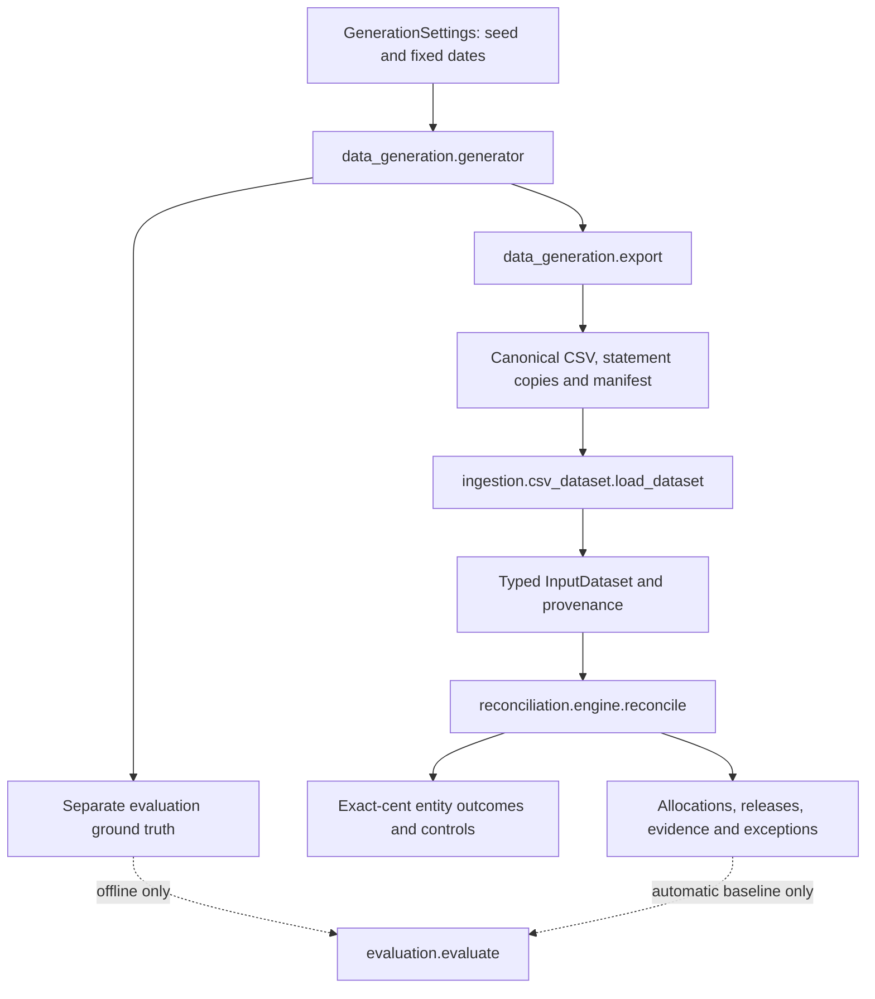
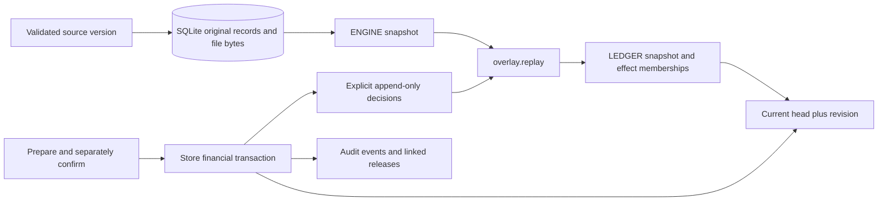
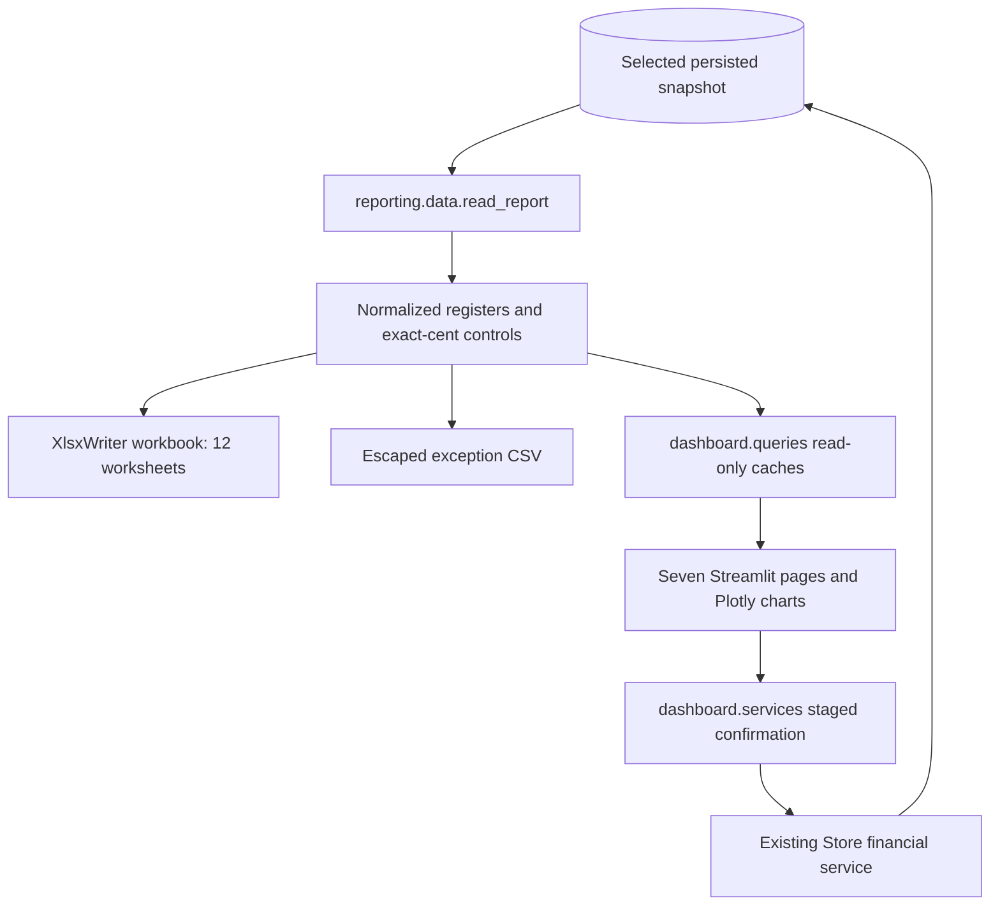

# Architecture

The implementation is a src-layout Python package with separate adapters,
financial logic, persistence and presentation. The CLI is registered by
`pyproject.toml`; the Streamlit entry is
`src/energy_reconciliation/dashboard/app.py`.

## Sources, matching and evaluation

The adapter checks hashes, typed records, source links, shared bank identities,
duplicate representations and approval evidence. Matching normalizes only outer
whitespace and case. A unique reference still requires eligible account/currency/
dates and open balances. Explicit combined references require an exact supported
split. Names or similar amounts cannot authorize a match. Rejected or ambiguous
evidence produces review items. Stable canonical hashes and UUID5 identities make
equivalent runs deterministic, including out-of-order source input.

## Persistence and operator authority

SQLAlchemy Core implements SQLite tables, checks, indexes, foreign keys and
immutable-table triggers. Version/signature and actual live DDL are validated.
`BEGIN IMMEDIATE`, case versions and ledger revisions guard operator writes;
idempotency keys handle retries. Effects, decision, snapshot, head and accepted
audit events commit atomically. Rejected attempts can append separate audit events
without partially changing money. Original records and past runs remain intact.

Current balances select one run's allocation/release memberships. Summing all
historical allocation rows would double-count independent snapshots. Undo creates
linked compensating effects, never erases the earlier decision. A cross-date
neutralization that would corrupt historical stocks is rejected during rebase.

## Reporting and dashboard

Read-only snapshot reconstruction never launches matching or changes the ledger.
Audit paging uses bound SQL queries separately from cached analytical rows. Cache
keys include database file stamps and selected run; writes invalidate views.
Dashboard confirmation binds intent to path, file identity, selected dataset and
stale tokens. These are safety checks for a trusted local demo, not authentication.

Money is integer EUR cents in business calculations; Decimal is used at text/
rounding boundaries. EUR floats appear only at Excel/chart display boundaries.
Business dates and UTC knowledge/audit timestamps are distinct. A historical
report selects a persisted exact-date run; it does not filter today's debt to
invent a historical balance.

For implementation contracts, see [data model](../DATA_MODEL.md),
[physical schema and transactions](../DATABASE_ARCHITECTURE.md),
[matching rules](../RECONCILIATION_ENGINE.md) and
[dashboard cache/write policy](../DASHBOARD_ARCHITECTURE.md).
