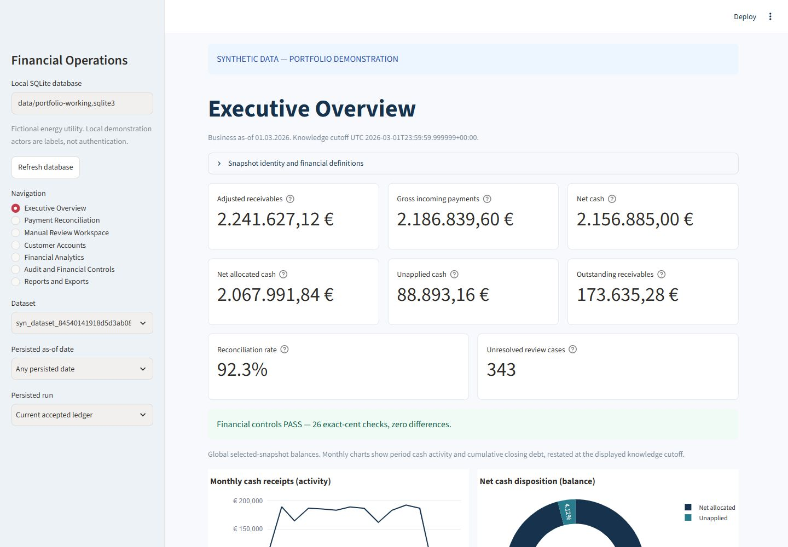
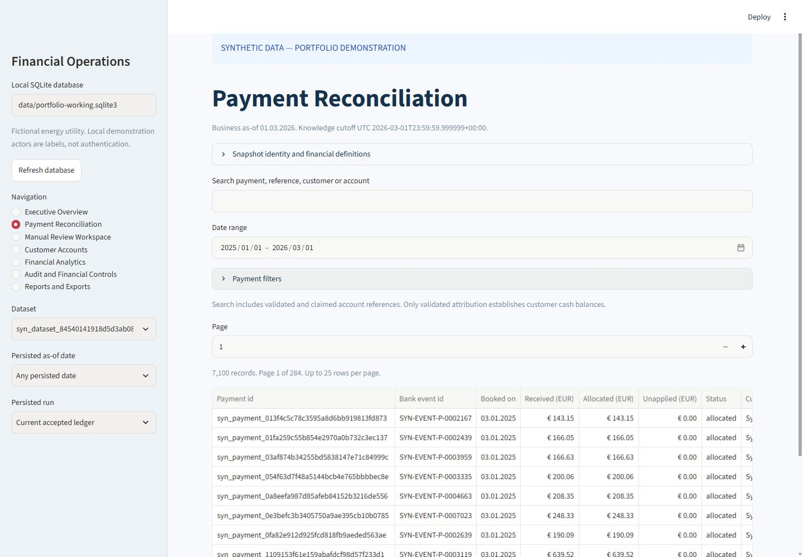
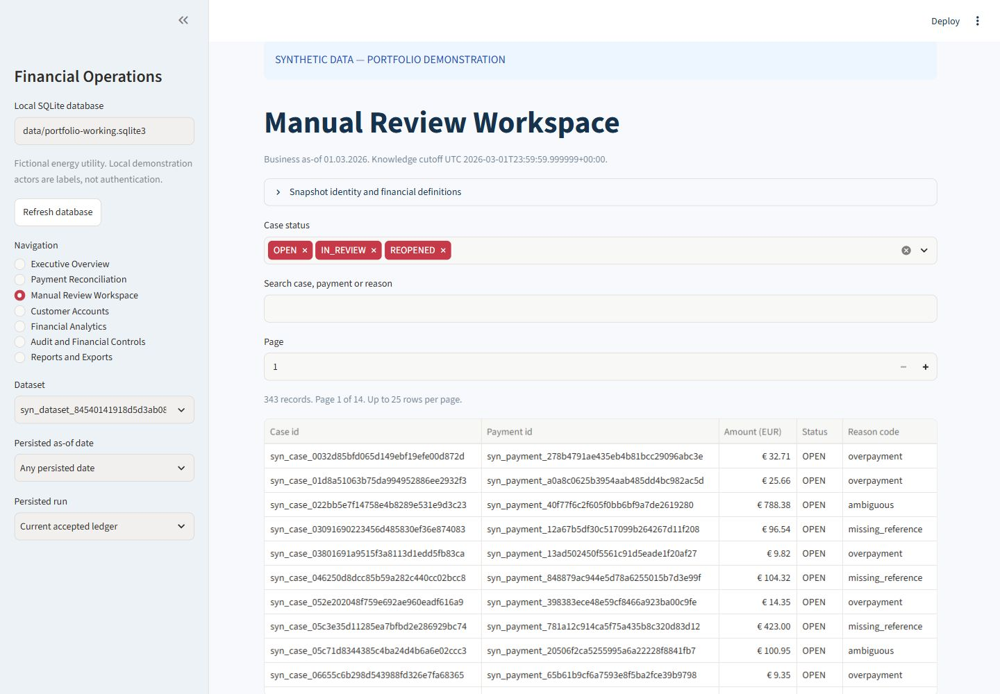
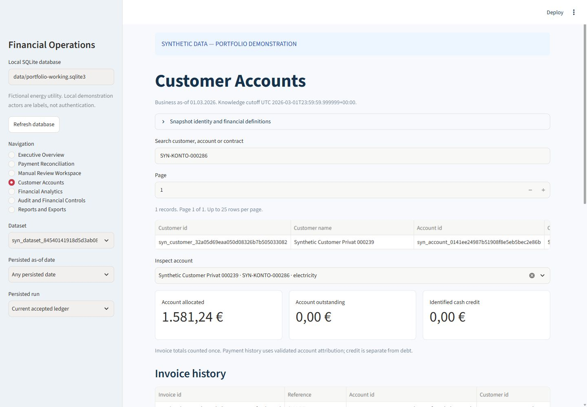
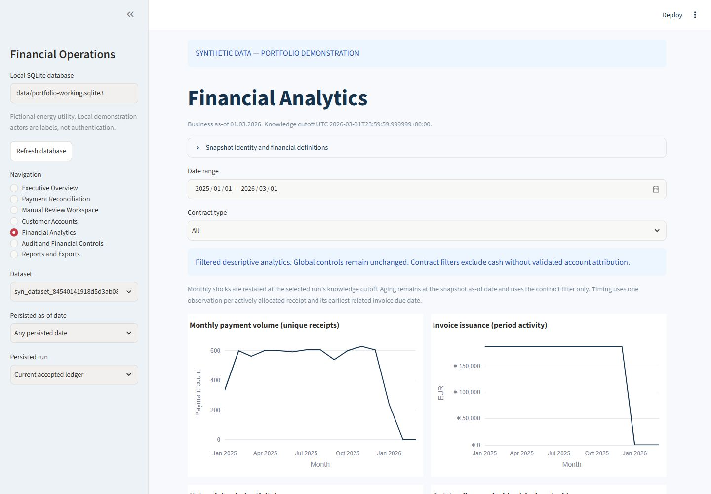
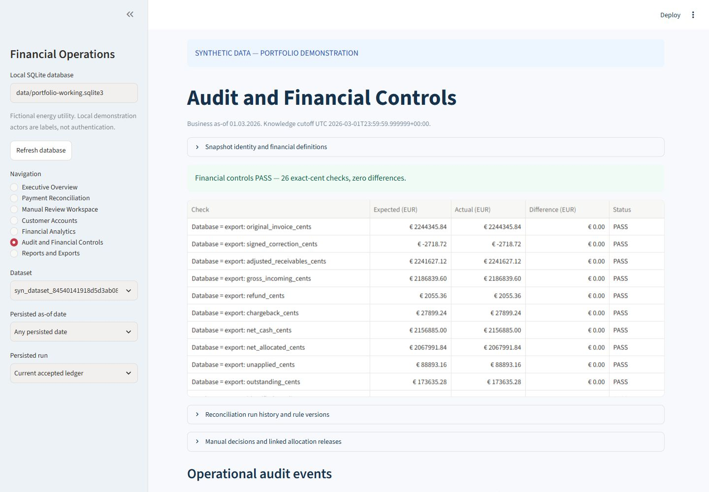
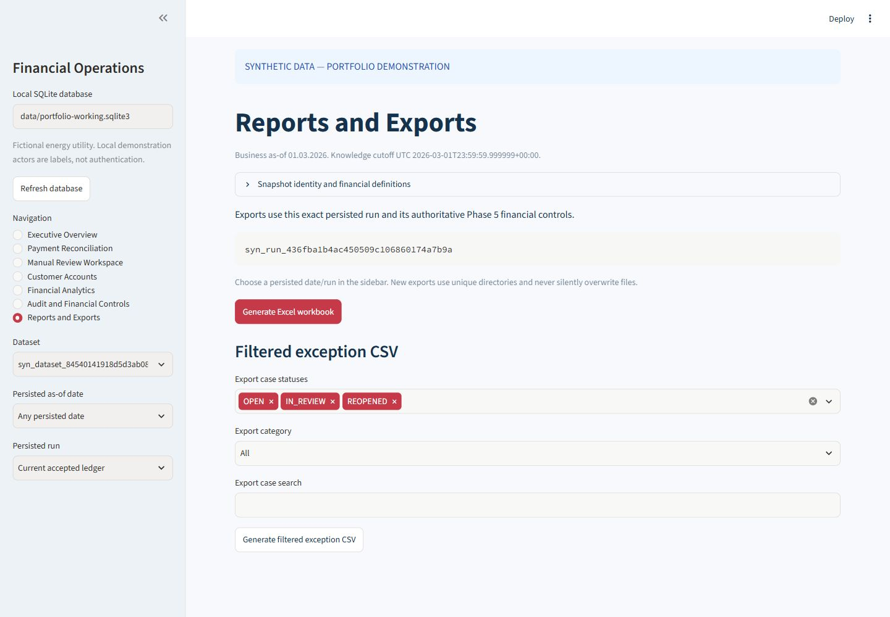

# Dashboard gallery

These are genuine 1440 × 1000 browser captures of the running local application,
using seed 42, 500 fictional customers and the fixed 1 March 2026 snapshot.
The browser used an isolated working database in read-only mode. No company data,
credentials, personal browser chrome or machine-specific user directory is shown.
Filters/collapsed sections and the selected fictional account are ordinary UI
interactions; image pixels were not composited or fabricated.

## Executive Overview

Six cash/receivables balances, settlement ratio, unresolved queue and controls.

## Payment Reconciliation

Search, date filtering and paginated receipts; advanced filters are collapsed.

## Manual Review Workspace

Unresolved cases retain a reason and amount. Detailed actions are below the queue;
financial edits were disabled for screenshot capture. The documented working-copy
demo enables explicit prepare/confirm and linked undo.

## Customer Accounts

One fictional contract's allocated amount, debt and identified cash credit.

## Financial Analytics

Monthly activity and cumulative stocks are labelled separately; global controls
remain unchanged by filters.

## Audit and Financial Controls

Selected-run detail-to-control comparisons, exact differences and retained history.

## Reports and Exports

Excel and exception CSV controls reuse the persisted reporting service.

Reproduce locally with the [demo guide](DEMO_GUIDE.md). Screenshots illustrate
the visible viewport, not every row or all actions. Native Excel rendering and
recalculation remain unverified.
